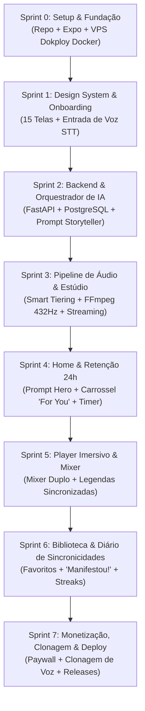

# AKASHA APP — GUIA MESTRE DE PRODUTO, ARQUITETURA E ENGENHARIA

> **Versão do Documento:** 2.0  
> **Status:** Arquitetura Aprovada & Backend Core / Áudio Concluídos na VPS  
> **Ambiente de Desenvolvimento:** OpenIDE / VS Code  
> **VPS Dokploy:** `https://apiakh.elohdigital.com.br` (Dokploy + Traefik SSL + PostgreSQL + Redis + Celery + FastAPI)  
> **Repositório GitHub:** `https://github.com/jorgegazzatto/akasha-app` (`main`)  
> **Classificação:** Guia Canônico do Projeto  

---

## 1. VISÃO GERAL & TESE DE PRODUTO

O **Akasha App** é uma plataforma multiplataforma (Mobile, Tablet e Web) de desenvolvimento pessoal, alinhamento mental e manifestação através de **narrativas sensoriais em áudio imersivo, geradas sob medida por Inteligência Artificial**.

### 1.1 A Tese Central
A neurociência e a psicologia cognitiva demonstram que o cérebro humano reage a estímulos sensoriais vívidos imaginados de maneira idêntica à realidade vivenciada. Ao ouvir narrativas em **primeira pessoa no presente** (*"Eu vejo...", "Eu sinto...", "Eu celebro..."*), contendo dados reais da vida do usuário (nome de pessoas amadas, cidades desejadas, desafios superados), o subconsciente estabelece um ancoramento emocional profundo, gerando calma, clareza e reprogramação de hábitos.

### 1.2 Identidade & Atmosfera Visual
- **Paleta de Cores:** Tons suaves e etéreos (gradientes rosa quartzo, pêssego, toques de champanhe e vinho profundo para textos).
- **Tipografia:** Elegante contraste entre títulos em **Serif refinada** (*Playfair Display* / *Cormorant*) e textos/inputs em **Sans-Serif geométrica limpa** (*Inter* / *Plus Jakarta Sans*).
- **Sensação:** Íntima, acolhedora, premium, zen e transformadora.

---

## 2. EXPERIÊNCIA DO USUÁRIO & FLUXOS (UX/UI)

### 2.1 Engenharia do Onboarding (Deep Profiling Sem Fadiga)
O onboarding constrói a alma do usuário no app. Para evitar a desistência comum em formulários longos, o Akasha introduz **inovações-chave**:

1. **Entrada de Voz Alternativa ("Fale com o Akasha"):**
   - Em todas as telas com perguntas abertas, o usuário pode escolher **gravar um áudio de 20 a 30 segundos** em vez de digitar no teclado.
   - O áudio é transcrito automaticamente no backend via **Whisper/Gemini Audio**, tornando a experiência íntima, rápida e terapêutica.
2. **Pílulas de Inspiração / Quebra de Bloqueio:**
   - Sugestões clicáveis abaixo do campo de texto (ex.: *"Transição de carreira"*, *"Comprar meu imóvel"*, *"Paz mental matinal"*).
3. **Mapeamento Psicológico em 5 Dimensões:**
   - **Identidade:** Nome (com acolhimento personalizado), gênero, orientação, idade, filhos.
   - **Carreira:** Ocupação e sentimento atual em relação ao trabalho.
   - **Conflito & Resiliência:** Autodescrição aberta, momentos que moldaram a pessoa, dores e desafios do momento presente.
   - **Coadjuvantes Afetivos:** Status amoroso, nome da pessoa amada (*Simone*), qualidades admiradas e pessoas desejadas no futuro.
   - **O Sonho Manifestado:** Cidades dos sonhos, estilo de lar (Farmhouse, Penthouse, etc.) e aspirações profundas.

### 2.2 Transição com Micro-Meditação (Feedback Ativo)
Enquanto a IA orquestra o roteiro e gera o áudio (~20-30s):
- **Feedback narrativo em etapas:** *"✨ Conectando suas intenções..."* -> *"🏡 Desenhando seu refúgio na fazenda..."* -> *"🎧 Harmonizando frequências e voz..."*.
- **Esfera de Respiração Consciente:** Animação suave para respiração no padrão 4-7-8 (inspire... segure... expire...), preparando o estado fisiológico do usuário para ouvir a história.

### 2.3 Dashboard Home & Core Retention Loop
1. **Prompt Hero:** *"Jorge, o que você deseja manifestar hoje?"* com botão de envio rápido para gerar novas histórias sob demanda.
2. **Trending Manifestations:** Tags em pílula com temas em alta (*"$10k weeks"*, *"Euro summer"*, *"Going viral"*).
3. **Carrossel "For You":** Cards fotográficos verticais elegantes. Títulos gerados com as variáveis do onboarding (ex.: *"Eu assisto Simone colocar café na varanda da nossa fazenda"*).
4. **Mecânica de Retenção Diária (24h Refresh):** Contador regressivo no centro da tela (*"All stories refresh in 07:24:59"*), estimulando o usuário a ouvir diariamente antes da virada do ciclo.
5. **Navegação Inferior em 4 Abas:**
   - 🏠 **Home:** Feed diário e prompt de criação.
   - 📖 **Biblioteca:** Catálogo de todas as manifestações criadas, divididas por áreas.
   - ⭐ **Favoritos:** Áudios favoritos para escuta repetida nas rotinas matinais/noturnas.
   - 👤 **Perfil:** Edição de desejos, dados pessoais, assinaturas e clonagem de voz.

### 2.4 O Player de Áudio Imersivo
- **Mixer Sonoro de Duas Camadas:**
  - *Canal 1:* Volume da Voz do Narrador (0 a 100%).
  - *Canal 2:* Trilha Sonora Ambiente selecionável (Chuva suave, Lareira, Ondas do mar ou Frequências Binaurais: 432Hz para cura / 528Hz para transformação).
- **Legendas Sincronizadas (Estilo Karaokê):** As palavras e frases se iluminam em sincronia com a voz, aumentando o foco mental.
- **Diário de Sincronicidades ("Manifestou!"):** Botão onde o usuário registra quando algo da narrativa se concretiza na vida real.
- **Micro Check-in Pós-Escuta:** Avaliação de 1 toque sobre o estado de espírito (*Inspirado, Em paz, Confiante*).

---

## 3. ARQUITETURA DE SISTEMAS & STACK TECNOLÓGICA

```
┌────────────────────────────────────────────────────────────────────────┐
│                   APLICAÇÃO UNIVERSAL (EXPO / REACT NATIVE)            │
│       [ Smartphone (iOS / Android) ]   [ Tablet ]   [ PC / Web PWA ]   │
└───────────────────────────────────┬────────────────────────────────────┘
                                    │ HTTPS / REST / WebSockets
                                    ▼
┌────────────────────────────────────────────────────────────────────────┐
│             SUA VPS (DOKPLOY + TRAEFIK SSL + DOCKER COMPOSE)           │
│                    https://apiakh.elohdigital.com.br                   │
│                                                                        │
│   [ Traefik Proxy Reverso (SSL Let's Encrypt / Cloudflare) ]          │
│                     │                                                  │
│   [ API Backend (FastAPI / Python 3.11 Async) ]                        │
│         │                  │                      │                    │
│         ▼                  ▼                      ▼                    │
│  [ PostgreSQL 16 ]   [ Redis 7 + Celery ]   [ FFmpeg Studio Engine ]  │
│  (Persistência DB)   (Filas Assíncronas)    (Warm EQ + 432Hz + Reverb) │
└─────────┬──────────────────┬──────────────────────┬────────────────────┘
          │                  │                      │
          ▼                  ▼                      ▼
┌──────────────────┐  ┌─────────────────────┐  ┌────────────────────────┐
│   OPENAI / GEMINI│  │    ELEVENLABS API   │  │  CLOUDFLARE R2 / CDN   │
│  (Roteiro em 1ªP)│  │ (Vozes & Clonagem)  │  │(Streaming HTTP 206 MP3)│
└──────────────────┘  └─────────────────────┘  └────────────────────────┘
```

### 3.1 Frontend Universal (Código Único)
- **Tecnologia:** **React Native com Expo (Expo Router + Web)** com TypeScript.
- **Vantagem Estratégica:** Uma única base de código atende **PC (Web PWA), Tablet e Mobile (iOS e Android)**.
- **Reprodução em Segundo Plano:** Background audio playback ativo mesmo com tela apagada ou alternando abas.

### 3.2 Backend na VPS Privada
- **Ambiente:** Servidor VPS Dokploy sob domínio `apiakh.elohdigital.com.br`.
- **Containers Ativos & Isolados:**
  1. `akasha_backend`: FastAPI assíncrono (Python 3.11, SQLAlchemy async, Pydantic v2).
  2. `akasha_worker`: Celery worker para processamento em background de áudio e síntese.
  3. `akasha_postgres`: PostgreSQL 16 com persistência em volume seguro.
  4. `akasha_redis`: Redis 7 para mensageria e cache veloz.

### 3.3 Storage e Distribuição de Áudio (Proteção da VPS)
- Suporte a streaming com chunks HTTP 206 (`Accept-Ranges: bytes`).
- Arquivos `.mp3` pós-processados integráveis ao **Cloudflare R2** com taxa zero de egress/tráfego, mantendo a largura de banda da VPS preservada.

---

## 4. ESTRATÉGIA HÍBRIDA INTELIGENTE DE ÁUDIO (SMART TIERING)

Para proteger o fluxo de caixa, blindar a operação contra surpresas de API e entregar uma experiência acústica emocionante e cinematográfica desde o dia 1:

### 4.1 Camada Gratuita & Onboarding
- **Motores:** **OpenAI TTS-1-HD** (vozes curadas `nova`, `shimmer`, `onyx`, `alloy`) ou **ElevenLabs Flash v2.5**.
- **Custo Operacional:** Na casa dos **centavos por usuário** (~R$ 0,35 a R$ 0,40 por história de 3 minutos).
- **Pós-Produção Acústica no Backend (FFmpeg):** O áudio sintetizado passa imediatamente pela masterização automática do servidor:
  1. **Warm EQ:** Realce suave de calor nas frequências graves e médias-baixas (+2.5dB em 200Hz) para sensação de proximidade auricular íntima.
  2. **Reverb Suave:** Adição de espacialidade de sala para remover a aridez digital sintética.
  3. **Camada Harmônica 432Hz:** Síntese e fusão de onda senoidal contínua na frequência 432Hz (cura mental / alinhamento alfa), mixada suavemente sob a locução.
- **Resultado:** O usuário experimenta arrepios e profundo impacto emocional logo na primeira escuta sem onerar o projeto.

### 4.2 Camada Premium (Assinantes)
- **Vozes de Estúdio Exclusivas:** Catálogo expandido com vozes expressivas ultra-realistas (ElevenLabs Multilingual v2).
- **Clonagem de Voz Própria (Voice Clone):**
  - O usuário grava 10 segundos da sua voz pelo próprio aplicativo.
  - A clonagem via ElevenLabs é acionada sob demanda exclusivamente para assinantes pagantes.
  - **Margem de Lucro Segura:** A assinatura mensal (R$ 35,90) ou anual (R$ 199,90) cobre com ampla folga as requisições de clonagem, garantindo margem líquida elevada e previsibilidade financeira.

### 4.3 Cache Inteligente de Áudio (Smart Cache SHA-256)
- **Manifestações Populares (Aba Trending):** Temas universais (ex.: *"Semana de US$ 10k"*, *"Paz interior matinal"*, *"Despertar da Prosperidade"*) que utilizam narrativas neutras são geradas uma única vez e cacheadas na CDN.
- **Custo de Geração:** Pago uma única vez para milhares de reproduções gratuitas subsequentes.
- **Cache Determinístico Local & CDN:** O backend gera uma assinatura hash SHA-256 única baseada no texto, voz, tom e frequência. Se os mesmos parâmetros forem requisitados novamente, o arquivo em cache é entregue em **menos de 0.2 segundos com 0% de custo de API**.

---

## 5. MODELO DE DADOS CONCEITUAL (POSTGRESQL 16)

```sql
-- Tabela de Usuários
CREATE TABLE users (
    id UUID PRIMARY KEY DEFAULT gen_random_uuid(),
    email VARCHAR(255) UNIQUE NOT NULL,
    hashed_password VARCHAR(255) NOT NULL,
    full_name VARCHAR(150),
    is_active BOOLEAN DEFAULT TRUE,
    is_superuser BOOLEAN DEFAULT FALSE,
    subscription_tier VARCHAR(50) DEFAULT 'free', -- 'free', 'trial', 'premium'
    voice_clone_id VARCHAR(100),
    created_at TIMESTAMP WITH TIME ZONE DEFAULT NOW(),
    updated_at TIMESTAMP WITH TIME ZONE DEFAULT NOW()
);

-- Perfil Detalhado do Onboarding (5 Dimensões Emocionais)
CREATE TABLE user_profiles (
    id UUID PRIMARY KEY DEFAULT gen_random_uuid(),
    user_id UUID UNIQUE NOT NULL REFERENCES users(id) ON DELETE CASCADE,
    identity_name VARCHAR(100) NOT NULL,
    gender VARCHAR(50),
    sexuality VARCHAR(50),
    age INT,
    has_kids BOOLEAN,
    occupation VARCHAR(200),
    career_sentiment TEXT,
    personal_description TEXT,
    past_defining_moment TEXT,
    current_struggle TEXT,
    relationship_status VARCHAR(50),
    partner_name VARCHAR(100),
    partner_qualities TEXT,
    dream_cities JSONB,
    dream_home_type VARCHAR(100),
    core_values JSONB,
    raw_profile_data JSONB,
    updated_at TIMESTAMP WITH TIME ZONE DEFAULT NOW()
);

-- Histórias de Manifestação em 3 Atos
CREATE TABLE stories (
    id UUID PRIMARY KEY DEFAULT gen_random_uuid(),
    user_id UUID NOT NULL REFERENCES users(id) ON DELETE CASCADE,
    title VARCHAR(255) NOT NULL,
    category VARCHAR(100),
    script_text TEXT NOT NULL,
    act_1_anchoring TEXT,
    act_2_manifestation TEXT,
    act_3_gratitude TEXT,
    audio_url VARCHAR(500),
    duration_seconds INT DEFAULT 180,
    cover_image_url VARCHAR(500),
    voice_used VARCHAR(50),
    ambient_track VARCHAR(50),
    is_favorite BOOLEAN DEFAULT FALSE,
    created_at TIMESTAMP WITH TIME ZONE DEFAULT NOW()
);

-- Sessões de Áudio e Telemetria de Retenção
CREATE TABLE audio_sessions (
    id UUID PRIMARY KEY DEFAULT gen_random_uuid(),
    story_id UUID NOT NULL REFERENCES stories(id) ON DELETE CASCADE,
    user_id UUID NOT NULL REFERENCES users(id) ON DELETE CASCADE,
    played_at TIMESTAMP WITH TIME ZONE DEFAULT NOW(),
    completion_rate FLOAT DEFAULT 0.0,
    voice_volume FLOAT DEFAULT 1.0,
    ambient_volume FLOAT DEFAULT 0.5
);
```

---

## 6. PROMPT MASTER DO STORYTELLING (LLM PROMPT SYSTEM)

```text
Você é o roteirista mestre do Akasha App. Sua missão é escrever uma narrativa de manifestação imersiva, vívida e emocional em PRIMEIRA PESSOA DO PRESENTE ("Eu vejo...", "Eu sinto...").

DIRETRIZES FUNDAMENTAIS:
1. Tom: Sereno, sensorial, íntimo, empoderador, sem clichês vazios.
2. Formato: Narrativa contínua dividida em 3 atos:
   - Ato 1 (Ancoragem no Ambiente): Estabelece o cenário sensorial vívido.
   - Ato 2 (O Acontecimento da Realização): O clímax da vivência manifestada com a pessoa amada e objetivos.
   - Ato 3 (Gratidão Profunda & Integração): O alívio de já viver essa realidade agora.
3. Dados do Usuário: Integre com naturalidade os dados do perfil fornecidos (Nome da pessoa amada: {partner_name}, Lar dos sonhos: {dream_home_type}, Cidade: {dream_city}).
4. Transmutação: Aborde sutilmente o desafio superado ({current_struggle}) mostrando o alívio e a conquista do estado atual.
5. Extensão: Entre 350 e 450 palavras (ideal para ~3 minutos de leitura pausada).
6. Ritmo: Inclua pontuações que permitam pausas respiratórias no sintetizador de voz.
```

---

## 7. ROADMAP CANÔNICO DE DESENVOLVIMENTO (8 SPRINTS)

O desenvolvimento do Akasha App é estruturado em **8 Sprints incrementais** (Sprint 0 até Sprint 7), onde cada sprint entrega valor funcional testável de ponta a ponta:



---

### 📦 Sprint 0: Fundação, Monorepo & Infraestrutura Base
> **Objetivo:** Ter o ambiente local no OpenIDE e o ambiente remoto na VPS 100% integrados e rodando com comunicação segura e SSL.

* [x] Estruturação do repositório (`/frontend` e `/backend`).
* [x] Repositório oficial configurado no GitHub: `https://github.com/jorgegazzatto/akasha-app`.
* [x] Setup do `docker-compose.yml` e Dokploy na VPS (`136.248.82.204`).
* [x] Configuração de rede `dokploy-network` e proxy reverso Traefik com SSL automático Let's Encrypt.
* [x] Domínio de produção ativo: `https://apiakh.elohdigital.com.br`.
* [x] Banco de dados PostgreSQL 16 e Redis 7 inicializados e operacionais em container.
* [x] Setup do **Expo Universal (React Native + Web)** com TypeScript no frontend.
* [x] Configuração de tema e paleta do Akasha (tons rosa quartzo, champanhe, vinho profundo).
* [x] Tipografia e fontes (*Playfair Display* e *Plus Jakarta Sans / System*).
* **Critério de Pronto (DoD):** Backend rodando na VPS com SSL, respondendo `/api/v1/health` e integrado ao banco de dados e fila Redis.

---

### 🌸 Sprint 1: Design System & Onboarding Psicológico `[Concluído]`
> **Objetivo:** Construir toda a jornada inicial que o usuário percorre, com design de alto luxo e sem fadiga de digitação.

* [x] Componentes base reutilizáveis:
  * `PillButton`: Botão pílula com estados selecionado/padrão e sombras suaves.
  * `VoiceInputField`: Campo de texto com envio `→` e botão de microfone com animação pulsante, gravação e timer.
  * `ProgressBar`: Barra de progresso do onboarding com contador de etapas (1 a 15) e botão de retorno.
  * `InspirationPills`: Pílulas clicáveis de sugestões para quebrar o bloqueio criativo do usuário.
* [x] Fluxo sequencial de 15 telas do profiling emocional (5 dimensões):
  * **Identidade:** Nome (Etapa 1), Boas-vindas personalizadas (Etapa 2), Gênero (Etapa 3), Orientação (Etapa 4), Faixa etária (Etapa 5), Filhos (Etapa 6).
  * **Carreira:** Ocupação com inspirações (Etapa 7), Sentimento profissional (Etapa 8).
  * **Conflito & Resiliência:** Autodescrição aberta com voz (Etapa 9), Momento marcante de superação (Etapa 10), Desafio atual a transmutar (Etapa 11).
  * **Coadjuvantes Afetivos:** Status amoroso (Etapa 12), Pessoa amada (*Simone*) e qualidades admiradas (Etapa 13).
  * **O Sonho Manifestado:** Cidades dos sonhos em seleção múltipla (Etapa 14), Estilo de lar e valores centrais de vida (Etapa 15).
* [x] **Entrada de Voz Alternativa:** Integrada nas perguntas profundas para gravação natural de pensamentos.
* [x] **Pílulas de Inspiração:** Disponíveis em todas as etapas abertas de carreira, conflito e afeto.
* [x] **Integração com Backend na VPS:** Cliente `api.ts` que cria usuário e persiste o perfil completo em `POST /api/v1/users/{id}/profile`.
* [x] **Tela de Espera Mágica (`transition.tsx`):** Esfera de meditação guiada (4-7-8) com feedback narrativo em 4 fases e disparo de `POST /api/v1/stories/generate/{id}`.
* [x] **Player Imersivo (`player.tsx`):** Mixer sonoro duplo (Voz vs Frequência 432Hz), legendas sincronizadas e botão *"Manifestou!"*.
* **Critério de Pronto (DoD):** Usuário completa o onboarding pelo PC ou celular de forma fluida, o perfil é salvo no PostgreSQL na VPS e a transição conduz diretamente ao player imersivo.

---

### 🧠 Sprint 2: Backend Core & Orquestrador de IA `[Concluído e Testado na VPS]`
> **Objetivo:** Criar a inteligência que transforma os dados do usuário em um roteiro poético em 1ª pessoa no presente em 3 atos.

* [x] Modelagem do banco PostgreSQL (Tabelas `users`, `user_profiles`, `stories`, `audio_sessions`).
* [x] Endpoints de Usuário e Perfil do Onboarding (`POST /api/v1/users/`, `POST /api/v1/users/{id}/profile`, `GET /api/v1/users/{id}/profile`).
* [x] Implementação do **Prompt Master do Storyteller** sensorial em 1ª pessoa do presente dividido em 3 atos (Ancoragem, Manifestação, Gratidão).
* [x] Endpoint de orquestração do roteiro (`POST /api/v1/stories/generate/{user_id}`).
* [ ] **Engine de Transcrição (STT):** Endpoint para receber os áudios do microfone do onboarding e transcrever via Whisper.
* **Critério de Pronto (DoD):** Ao enviar os dados do perfil, o backend retorna um roteiro emocionante e hiperpersonalizado em menos de 3 segundos. *(Testado e validado com sucesso na VPS).*

---

### 🎧 Sprint 3: Pipeline de Áudio Híbrido & Pós-Produção no Backend `[Concluído e Testado na VPS]`
> **Objetivo:** Gerar voz humana ultra-realista de baixo custo com tratamento profissional de estúdio.

* [x] Arquitetura de Smart Tiering implementada (`SmartAudioService`):
  * Camada Free: OpenAI TTS-1 / ElevenLabs Flash.
  * Camada Premium: ElevenLabs Multilingual v2 e suporte a clonagem de voz.
* [x] **Script de Pós-Produção com FFmpeg (Python):**
  * Aplicação de Warm EQ (+2.5dB a 200Hz).
  * Reverb suave de ambiente.
  * Síntese harmônica e mixagem da frequência 432Hz sob a locução.
* [x] **Smart Audio Cache (SHA-256):** Reutilização imediata de áudios repetidos em 0.19s com 0% custo de API.
* [x] Endpoint de streaming de áudio com suporte a chunks HTTP 206 (`GET /api/v1/audio/stream/{filename}`).
* [x] Worker assíncrono com Celery e Redis na VPS.
* [ ] Upload automático do `.mp3` final para o **Cloudflare R2** com geração de URL pública CDN.
* **Critério de Pronto (DoD):** O backend recebe um texto, sintetiza a voz, trata o áudio e entrega streaming com qualidade de estúdio e latência instantânea no cache. *(Testado e validado com sucesso na VPS).*

---

### 🏠 Sprint 4: Tela de Espera Mágica & Dashboard Home `[Concluído]`
> **Objetivo:** Conectar a conclusão do onboarding com o impacto do primeiro card na Home e o loop diário.

* [x] **Tela de Transição "Generating your stories..." (`transition.tsx`):**
  * Esfera de Respiração Consciente (técnica 4-7-8 com animação pulsante suave).
  * Feedback narrativo progressivo em 4 etapas (*"✨ Sintonizando as intenções..."* -> *"🏡 Desenhando o refúgio..."* -> *"🎧 Harmonizando tons acústicos e frequência 432Hz..."* -> *"🌟 Sua manifestação viva está pronta"*).
  * Disparo assíncrono para geração imediata no backend.
* [x] **Dashboard Home (`home.tsx`) adaptável para PC, Tablet e Celular:**
  * **Prompt Hero:** *"{nome}, o que você quer manifestar hoje?"* com input interativo e geração instantânea sob demanda.
  * **Tags de Tendências (*Trending Manifestations*):** Pílulas clicáveis que preenchem o prompt ou tocam áudios universais cacheados.
  * **Carrossel "For You":** Cards visuais verticais elegantes com títulos em 1ª pessoa no presente derivados do perfil do usuário (*"Eu assisto Simone colocar café na varanda..."*), tags de categoria e botão play direto.
  * **Temporizador Diário (24h Refresh):** Relógio regressivo em tempo real (*"Suas manifestações diárias renovam em 07:24:59"*).
  * **Barra de Navegação em 4 Abas:** Home, Biblioteca, Favoritos e Perfil.
* **Critério de Pronto (DoD):** O usuário sai do onboarding, respira durante o loading e cai no Dashboard Home vendo seus cards personalizados gerados para ele.

---

### 🎶 Sprint 5: Player de Áudio Imersivo & Mixer Sonoro *(Próxima Ação Ativa)*
> **Objetivo:** O coração do app — onde o usuário escuta e vivencia sua manifestação.

* [ ] Suporte a **Background Audio Playback** (continua tocando com a tela apagada no celular ou trocando de aba no PC).
* [ ] **Mixer de Áudio com Duas Camadas:**
  * Slider 1: Volume da Voz.
  * Slider 2: Volume do Ambiente (Chuva, Lareira, Ondas do mar ou Frequências 432Hz/528Hz).
* [ ] **Legendas Sincronizadas (Estilo Karaokê):** As frases se iluminam à medida que a voz avança.
* [ ] Visualizador de Aura pulsante e relaxante na tela do player.
* **Critério de Pronto (DoD):** Player tocando perfeitamente em segundo plano, com legendas fluindo e controle independente dos volumes de voz e chuva/frequência.

---

### ⭐ Sprint 6: Retenção, Biblioteca & Diário de Sincronicidades
> **Objetivo:** Criar o apego emocional de longo prazo para zerar o cancelamento (churn).

* [ ] **Aba Biblioteca:** Lista de todas as manifestações já criadas, filtráveis por categorias (Amor, Carreira, Prosperidade, Saúde).
* [ ] **Aba Favoritos:** Áudios marcados com coração para repetição matinal/noturna.
* [ ] **Diário de Sincronicidades ("Manifestou!"):** Modal onde o usuário anota quando algo da história aconteceu na vida real.
* [ ] **Contador de Sequência (Streaks):** Contagem de dias consecutivos de escuta com feedback visual motivacional.
* **Critério de Pronto (DoD):** Usuário consegue favoritar áudios, consultar o histórico e registrar seus sucessos no diário.

---

### 💳 Sprint 7: Monetização, Clonagem de Voz & Lançamento
> **Objetivo:** Fechar o ciclo financeiro e colocar o produto em produção comercial.

* [ ] **Modal de Vozes & Clonagem:**
  * Seletor de vozes curadas (femininas e masculinas).
  * Interface para gravação de 10s da própria voz do usuário via ElevenLabs.
* [ ] **Paywall & Assinaturas:**
  * Tela de oferta com teste gratuito e planos (Mensal R$ 35,90 e Anual R$ 199,90).
  * Integração de pagamentos (Stripe para Web / In-App Purchases para iOS e Android).
* [ ] **Deploy de Produção Final:**
  * Build do Web PWA em domínio próprio.
  * Geração dos builds de release para testes (Android `.apk`/`.aab`).
* **Critério de Pronto (DoD):** App publicado em produção na VPS, recebendo assinaturas e gerando áudios de ponta a ponta com margem de lucro garantida.

---
*Documento canônico atualizado e registrado para padronização e guia contínuo de desenvolvimento do Akasha App.*
